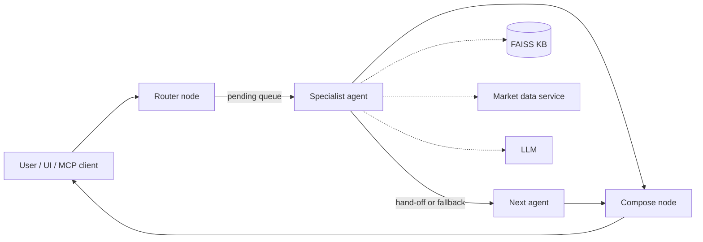
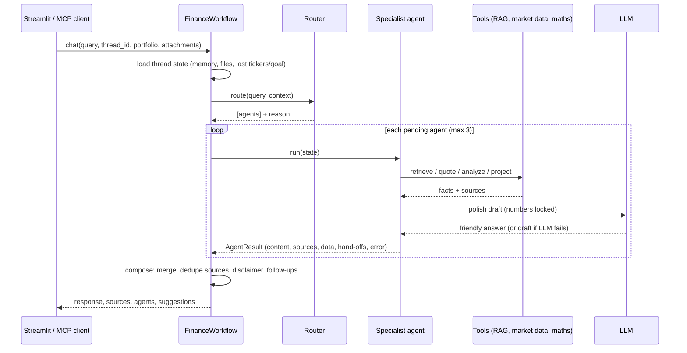

# Architecture

## Data flow



User Query (typed, spoken or with files) → **Router** (LLM classification, keyword fallback) → **Agent(s)** → **RAG retrieval** → **LLM processing** of a tool-computed draft → **Compose** (merge, dedupe sources, disclaimer, suggested follow-ups) → UI.

### One turn, step by step



## Agents

| Agent | Tools | Output data (for UI) |
|---|---|---|
| `finance_qa` | KB retrieval, glossary lookup | glossary terms |
| `portfolio_analysis` | quotes, `analyze_portfolio` | allocation, flags, drift, rebalancing $, stress tests, return per unit of risk |
| `market_analysis` | quotes / overview with freshness, daily history → `trend_metrics` | quotes, trends; hands off to news on "why" questions |
| `goal_planning` | `plan_goal`, Monte Carlo | projection schedule and percentile bands |
| `news_synthesizer` | Alpha Vantage news sentiment | headlines and sentiment |
| `tax_education` | KB (taxes, retirement), current IRS limits | — |

All agents extend `BaseAgent`, which provides uploaded-file context (when files were attached this turn or the question refers to them), retrieval with category filters, context formatting with numbered citations, conversation-history injection, a shared style guide (teach, don't sell; no invented numbers), timing, and exception capture.

**Draft-then-polish pattern.** Each agent first computes a deterministic draft (numbers from tools, retrieved facts). The LLM rewrites the draft into a friendly explanation but is told to use only the draft's numbers. If the LLM is missing or fails, the draft itself is the answer.

## Communication protocol

Agents never call each other. They share a typed state (`core/state.py`) and return an `AgentResult` envelope:

```python
AgentResult(agent, title, content, sources, data, confidence, handoffs, error)
```

- `handoffs`: names of agents to run next (e.g. market → news). The orchestrator de-duplicates and enforces `max_agents_per_turn`.
- `error`: set by `BaseAgent.run` on any exception. The orchestrator then queues `finance_qa` as a fallback.
- `data`: structured payload consumed by the Streamlit dashboard and MCP tools.

## State and memory

`FinanceState` holds persistent fields (`messages` with an append reducer, `user_profile`, `portfolio`, `context`) and per-turn fields reset by the router (`route`, `pending`, `completed`, `results`). LangGraph's `MemorySaver` checkpoints state per `thread_id`, so follow-ups ("what about its dividend?") can use `context.last_tickers`, `context.last_goal`, and `context.last_agents`. Agents see the last `history_window` messages.

## Fallback ladder

1. LLM router → keyword router (including "what if…" follow-ups to the previous specialist).
2. LLM generation → tool-computed draft.
3. Agent exception → `finance_qa` fallback agent.
4. All agents fail → apologetic generic answer.
5. Workflow exception → error message (UI keeps running).
6. Market data: Alpha Vantage (one retry with backoff on network errors) → yFinance → stale cache (labelled) → sample data (labelled).
7. Uploaded files: unreadable, unsupported or password-protected files become a note, never an error; scans and images need an LLM provider.
8. Agents that only ask for missing input ("I need your holdings") are dropped from the answer when another agent answered.

## RAG pipeline

`loader` (102 articles, 104 glossary terms) → `chunker` (sentence-aware, 600 chars, 100 overlap, title prefixed) → `embeddings` (hashing offline; sentence-transformers / OpenAI / Gemini optional) → `FaissStore` (`IndexFlatIP` on normalised vectors; NumPy fallback) → `Retriever` (top-k×6 dense candidates, hybrid score = 0.75·cosine + 0.25·keyword overlap, threshold, one chunk per article, category filters) → citations `{title, category, url, score}`. The index is cached under `.cache/` keyed by a fingerprint of the KB and chunk settings.

## Market data

`MarketDataService` wraps providers behind one interface with a TTL cache (memory + disk), a sliding-window rate limiter matching Alpha Vantage's free tier (5/min, 25/day, configurable), and freshness metadata: `live`, `cached`, `stale`, or `sample`, with a human-readable label shown in answers and the UI.

## Uploaded files and voice

`core/attachments.py` turns each upload into `{name, kind, text, note}`: PDFs via `pypdf` (scans fall back to LLM vision on the page images), images via LLM vision after resizing, Word via `python-docx`, Excel via pandas/openpyxl, CSV/JSON/text directly. Documents are appended to `FinanceState.documents` (a reducer), so they persist per thread. For each question, `select_passages` keeps each file's opening plus the passages sharing the most words with the question, within a character budget, and the text is marked as data, not instructions.

Voice: Streamlit's chat input records audio; `LLMClient.transcribe` sends it to OpenAI speech-to-text (`TRANSCRIBE_MODEL`, default `whisper-1`), and the text runs through the same workflow.

## Market and portfolio insights

- `utils/trends.py`: 1-month and 3-month returns, 20/50-day moving averages and an uptrend/downtrend/mixed reading, annualized volatility with a level, max drawdown, and one plain-English sentence per metric.
- `utils/portfolio.py`: on top of allocation, HHI, diversification score and correlation-aware volatility, it adds dollar rebalancing amounts toward the reference mix, a return-per-unit-of-risk ratio, and stress tests that apply approximate asset-class moves from 2008, the 2020 crash and 2022 to today's mix.
